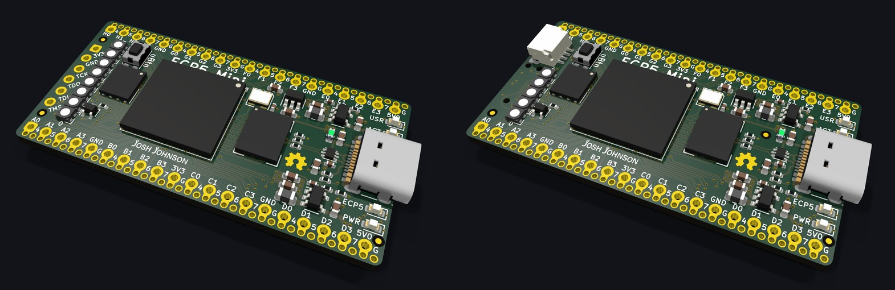
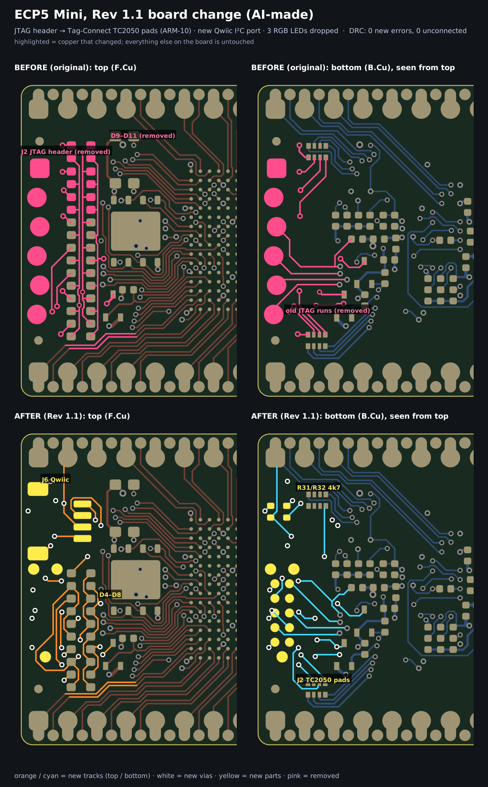
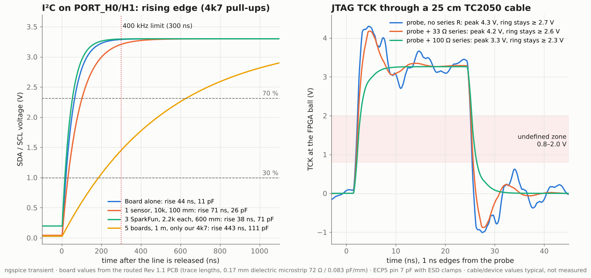
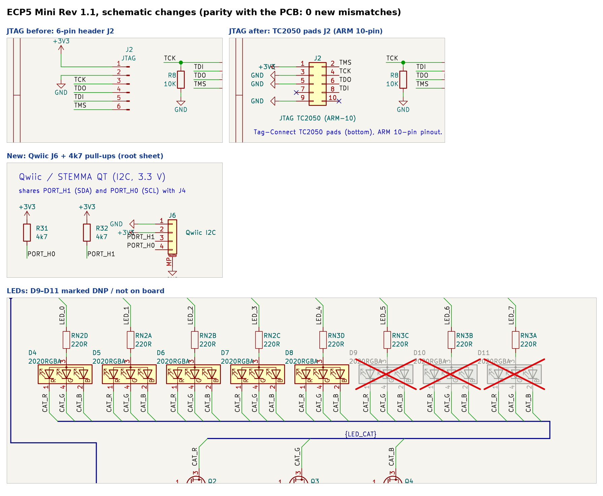

# ECP5 Mini, modified (Rev 1.1)

A modified version of the open-source **[ECP5 Mini](https://github.com/joshajohnson/ecp5-mini) by [Josh Johnson](https://github.com/joshajohnson)**: a Lattice ECP5 FPGA board in the Black Mesa Labs "S7 Mini" form factor.

The original design is Josh Johnson's work, © Josh Johnson, licensed under the [CERN Open Hardware Licence v2, Strongly Reciprocal](LICENSE). This repository is a derived work under the same licence. It is **not** affiliated with or endorsed by the original author. See [CHANGES.md](CHANGES.md) for exactly what was modified.

The modifications were made with AI assistance (Claude Opus 5.5) as an experiment: can an AI make a real engineering change to a finished, densely routed 4-layer board? The change is **a concept that has not been built or tested on hardware**.



## What changed

| | Original (r0.1) | This version (Rev 1.1) |
|---|---|---|
| JTAG | 6-pin 2.54 mm header (J2) | Tag-Connect TC2050-IDC-NL pads on the bottom side, ARM Cortex 10-pin pinout |
| I²C | none | Qwiic / STEMMA QT connector (J6), 4k7 pull-ups (R31, R32) |
| RGB LEDs | 8 (D4–D11) | 5 (D4–D8); D9–D11 removed to make room |

- **I²C pins:** the Qwiic port **shares the FPGA pins PORT_H1 (SDA) and PORT_H0 (SCL)** with header J4, pins 1 and 3. None of the unused FPGA balls could be routed to the connector without disturbing the dense BGA fan-out, which the change was not allowed to touch.
- **DRC (layout check):** 0 new errors and 0 unconnected items compared with the original.
- **Schematic:** updated to match the board. The schematic-vs-PCB parity check finds 0 new mismatches.



## Checks

- **KiCad 9 DRC:** no new violations against the original board. The errors that remain were already in the original. Reports are in `hardware/rev1.1/reports/`.
- **Schematic parity:** no new mismatches.
- **SPICE (ngspice):**
  - I²C rise time is within the 400 kHz limit (300 ns) up to about 75 pF of bus capacitance.
  - Several Qwiic boards that each add their own 2.2k pull-ups load the bus too much: a weak device may only pull the line down to about 0.57 V instead of the 0.4 V the spec allows. Disable the extra pull-ups.
  - JTAG TCK through a 25 cm TC2050 cable shows no double clocking.
  - See `scripts/spice/`.





## Open points before building
- Check the TC2050 retaining-clip clearance against the Tag-Connect drawing (the "NL" footprint without legs is used).
- With several Qwiic boards chained, disable their on-board pull-ups.
- Order a prototype and test: JTAG IDCODE readout over the TC2050, then an I²C bus scan.

## Repository layout

```
hardware/rev1.1/      KiCad project (schematic, PCB, lib tables) and DRC / ERC / parity reports
josh-kicad-lib/       git submodule: Josh Johnson's KiCad library (symbols, footprints, 3D models),
                      pinned to the same commit as the original ECP5 Mini
docs/images/          before/after layout, schematic changes, SPICE plots, 3D renders
docs/video/           speedrun video of the change (square and vertical)
scripts/eco/          placement change, grid router, write-back and fix-up scripts (KiCad 9 pcbnew Python)
scripts/spice/        ngspice set-ups for I²C and TCK
scripts/video/        video animation and soundtrack scripts
```

Clone with submodules so the libraries and 3D models resolve:

```
git clone --recursive https://github.com/Hauke12345/ECP5-modified
```

Open `hardware/rev1.1/ecp5-mini.kicad_pro` in KiCad 9. The scripts are kept as they were run: they use absolute paths from the working environment and need adapting before reuse.

## Credits
- **Original design: [ECP5 Mini](https://github.com/joshajohnson/ecp5-mini) by Josh Johnson** ([GitHub](https://github.com/joshajohnson), [X/Twitter](https://twitter.com/_joshajohnson)), based on upstream commit `711a78e` ("update silk to clear connectors", 2020-10-19).
- The original README credits Black Mesa Labs' S7 Mini (form factor), Greg Davill's OrangeCrab and ButterStick, and Matt Venn's Basic ECP5 design as references.
- KiCad library: [josh-kicad-lib](https://github.com/joshajohnson/josh-kicad-lib) by Josh Johnson.
- Modifications: Hauke Carstensen, with Claude (Anthropic).

## Licence
CERN-OHL-S v2. See [LICENSE](LICENSE). Under this licence, any further modified versions must also be published under CERN-OHL-S, keep these notices, and state their own changes.
